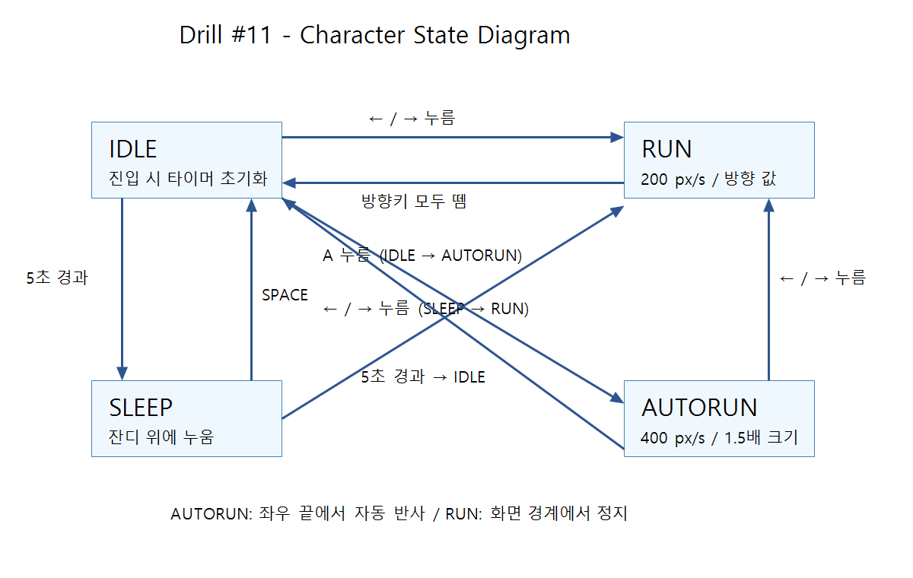

# Drill #11 — AutoRun

## 실행
Python 가상환경에서 다음을 실행합니다. 실행 파일은 boy.py가 아닌 main.py입니다.

```powershell
python -m pip install -r requirements.txt
python main.py
```

위 명령은 이 저장소 폴더 안에서 실행합니다.

## 조작
- IDLE에서 A: AutoRun 시작
- ← / →: 일반 RUN (SLEEP/AUTORUN에서도 즉시 RUN 전환)
- 방향키 모두 떼기: IDLE
- IDLE 5초: SLEEP
- SLEEP에서 SPACE: IDLE
- ESC: 종료

AutoRun은 5초 동안 일반 달리기의 2배 속도, 1.5배 크기로 움직이며 좌우 끝에서 반사합니다.

## 상태 그림


## 검증
```powershell
python -m unittest -v
```
4개 자동 테스트: 속도/크기/5초 복귀, 양쪽 경계 반사, 양쪽 방향키 취소, 기존 수면 기능.
실제 창의 모습은 실행 후 확인해야 합니다. 테스트는 시간과 이미지 로딩을 대체하여 로직을 검사합니다.

## 포함 파일
- main.py, boy.py, grass.py, auto_run.py: 실행 코드
- animation_sheet.png, grass.png: 실행에 필요한 원본 이미지
- PRD.md: 요구사항 및 개발 계획
- state_diagram.png: 제출용 상태 그림
- requirements.txt, test_autorun.py: 의존성 및 동작 검증

## 개발 이력
첫 커밋은 이미 존재하던 IDLE/RUN/SLEEP 코드를 가져온 기준점입니다.
이후 AutoRun 구현, 자동 검증, 문서/상태 그림을 실제 작업 순서대로 커밋했습니다.
이전에 수행한 개발 과정을 소급해서 기록한 이력은 아닙니다.
